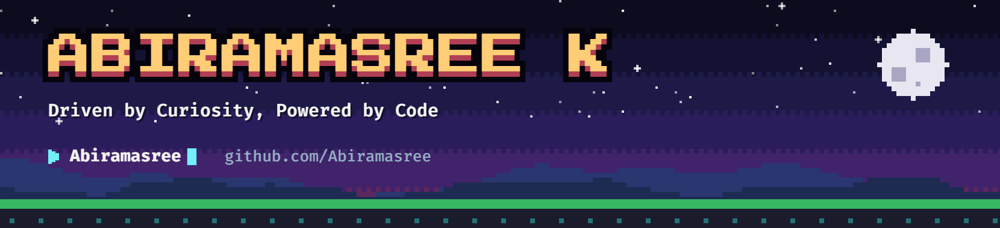

<picture>
  <source media="(prefers-color-scheme: dark)" srcset="header-dark.png">
  <source media="(prefers-color-scheme: light)" srcset="header-light.png">
  
</picture>

<h1 align="center">Hey there! I'm Abiramasree 👋</h1>

<h3 align="center">
  CSE Student | Developer | AI & ML Enthusiast
</h3>

  Building projects, exploring technology, and learning something new every day! ✨

---

### 👩‍💻 About Me

- 🎓 B.Tech Computer Science Engineering student at SRM University AP.
- 💻 Interested in Software Development and Artificial Intelligence.
- 🤖 Exploring Machine Learning, Deep Learning and Robotics.
- 🌱 Currently improving my skills in Python, Web Development and AI/ML.
- 🚀 Love building practical projects and solving problems.
- 🤝 Open to learning, collaboration and exciting opportunities.

---

### 🛠️ Tech Stack

  

### 🚀 Featured Projects

| Project | Description |
|---|---|
| [Personal Expense Tracker](https://github.com/Abiramasree/expense-tracker) | Expense tracking and visualization using Python and Streamlit |
| [Auction App](https://github.com/Abiramasree/auction-app) | Full-stack online auction application |
| [Invisible Cloak](https://github.com/Abiramasree/Invisible-Cloak-Python) | Computer vision project using Python and OpenCV |
| [Hospital Management](https://github.com/Abiramasree/Hospital-patient-management-system-using-sll) | Hospital management using linked lists in C |
| [ML Pandas](https://github.com/Abiramasree/ML_pandas) | Machine learning and data analysis practice |

---

### 📊 GitHub Statistics

  
  

  

---

### 🌐 Connect With Me

  
  

  <i>✨ Keep learning. Keep building. Keep growing. ✨</i>

